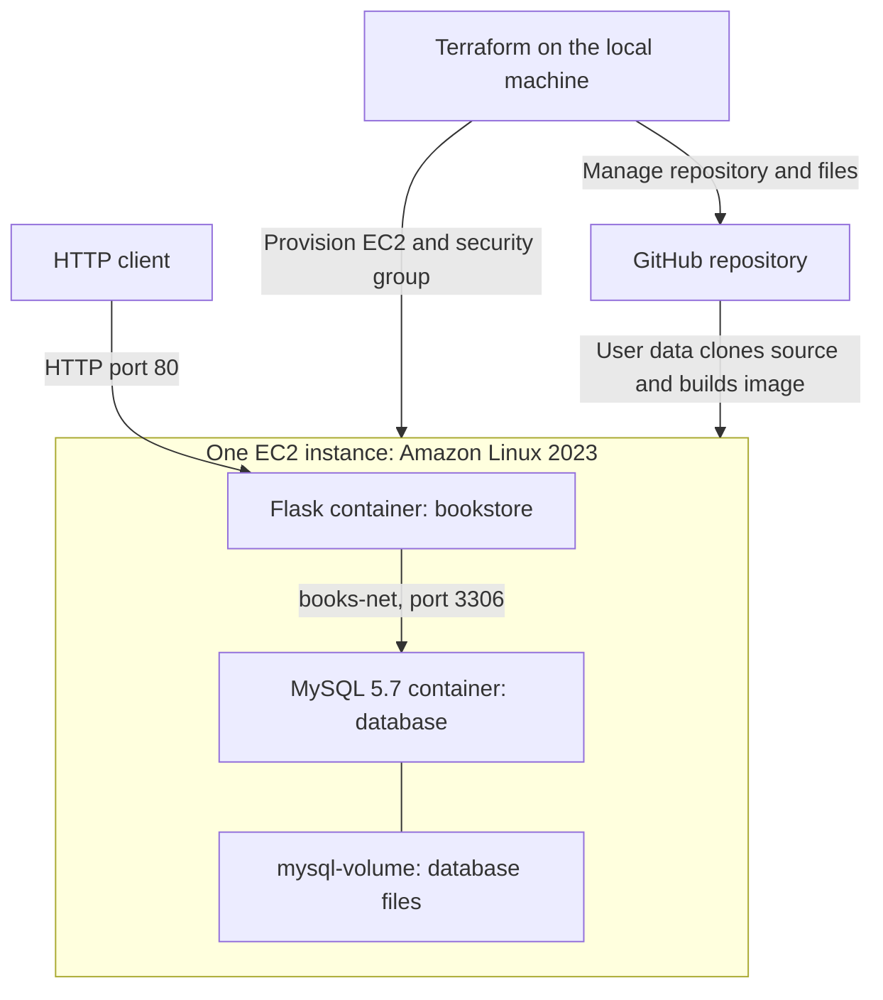

# Bookstore API on AWS

**Python Flask · MySQL · Docker Compose · Terraform**

A hands-on deployment of a REST API for managing book records. Terraform provisions an Amazon Linux 2023 EC2 instance and a security group, and also manages the GitHub repository, its default branch, and four application files. The EC2 user-data script builds the application image and starts Flask and MySQL with Docker Compose.

Deployment implementation: [Yazen Albu](https://github.com/yazenAlbu). Based on the supplied Project 203 course starter files.

## Architecture



- Flask serves the API on container port `80`, published as EC2 port `80`.
- MySQL runs in a separate container on the same EC2 instance.
- The services communicate over `books-net`; MySQL port `3306` is not published to the host.
- `mysql-volume` is mounted at `/var/lib/mysql` to retain database files across container recreation.
- Compose waits for the MySQL health check before starting the API.

## Configuration

| Setting | Current value |
| --- | --- |
| AWS Region | `us-east-1` |
| EC2 operating system | Amazon Linux 2023, latest matching Amazon-owned x86_64 AMI |
| EC2 instance type | `t3.small` |
| Existing EC2 key pair | `linuspass` |
| GitHub account | `yazenAlbu` |
| Repository | `bookstore-api-app`, public |
| Application image | `bookstore:latest`, built on EC2 |
| Python base image | `python:3.13.2-alpine3.21` |
| Database image | `mysql:5.7` |
| Network / volume | `books-net` / `mysql-volume` |

The default VPC and EC2 key pair must already exist in `us-east-1`; this Terraform configuration does not create them. The security group permits SSH on port `22` and HTTP on port `80`.

## Repository files

| File | Purpose |
| --- | --- |
| [bookstore-api.py](bookstore-api.py) | Flask routes, database access, table initialization, and three seed books. |
| [requirements.txt](requirements.txt) | Python dependencies: Flask 2.3.3 and Flask-MySQL. |
| [Dockerfile](Dockerfile) | Builds the Flask application image. |
| [compose.yaml](compose.yaml) | Defines both services, the network, volume, and database readiness check. |
| [main.tf](main.tf) | GitHub resources, security group, AMI lookup, and EC2 instance. |
| [providers.tf](providers.tf) | AWS and GitHub providers. |
| [variables.tf](variables.tf) | GitHub token input, account, key pair, instance type, and managed application files. |
| [user-data.sh](user-data.sh) | Installs Docker, Git, and Compose, then clones, builds, and starts the application. |
| [outputs.tf](outputs.tf) | Returns the deployed website URL. |
| [.terraform.lock.hcl](.terraform.lock.hcl) | Locks the provider versions used by Terraform. |
| [.gitignore](.gitignore) | Excludes local Terraform state, plans, credentials, and working files. |

## Prerequisites

- Git and Terraform CLI on the local machine.
- AWS CLI credentials configured for the intended AWS account.
- A default VPC with public subnets in `us-east-1`.
- The `linuspass` EC2 key pair in that Region; retain its matching private key locally for SSH.
- A GitHub personal access token with permission to administer this public repository and write its contents. It must authenticate the same account configured in `git-user-name`.

Terraform prompts for `git-token` when needed. Its value is marked sensitive and has no hardcoded default. Enter the token locally; do not put it in committed files. Keep Terraform state and saved plans local because they can contain sensitive information.

Docker is installed on EC2 by user data. Before applying from Windows, save `user-data.sh` with **LF** line endings.

## Deploy

The commands below use PowerShell, matching the local workflow used for this project.

### 1. Clone the project

```powershell
git clone https://github.com/yazenAlbu/bookstore-api-app.git
cd bookstore-api-app
```

Review the values in `variables.tf`, especially the GitHub account, key pair, and instance type. The AWS Region is set in `providers.tf`.

### 2. Initialize Terraform

```powershell
terraform init
```

### 3. Import the existing repository when using fresh state

This repository already exists. When deploying this project from a **fresh clone with no local Terraform state**, register it with Terraform once:

```powershell
terraform import github_repository.myrepo bookstore-api-app
```

Use the repository name as the import ID. If reusing the original working directory and retained state, skip this import when the repository is already managed.

The existing `main` branch is handled by the branch resource. The application-file resource uses `overwrite_on_create = true` to manage the four existing application files.

### 4. Review and apply

```powershell
terraform plan
terraform apply
```

Review the plan before confirming. For this deployment, no repository deletion or replacement is expected.

The EC2 user-data script installs the required software, clones the public repository, builds `bookstore:latest`, and runs `docker-compose up -d`. Infrastructure creation can finish before this bootstrap process completes.

### 5. Get the application URL

```powershell
terraform output
```

Open the `website-url` output for the welcome message, or append `/books` to list the books. The public IP is assigned at deployment time, so it is not stored here as a permanent demo link.

## API

Each book has these fields:

| Field | Meaning |
| --- | --- |
| `book_id` | Automatically generated numeric identifier. |
| `title` | Book title; required when creating a book. |
| `author` | Author name; optional when creating a book. |
| `is_sold` | Boolean sale status; defaults to `false` and can be changed with `PUT`. |

Responses use JSON, except for the welcome message at `/`. For requests with a JSON body, use `Content-Type: application/json`.

| Method | Path | Action |
| --- | --- | --- |
| `GET` | `/` | Welcome message. |
| `GET` | `/books` | List all books. |
| `GET` | `/books/{book_id}` | Read one book. |
| `POST` | `/books` | Create a book. |
| `PUT` | `/books/{book_id}` | Update a book. |
| `DELETE` | `/books/{book_id}` | Delete a book. |

Replace `{book_id}` with the actual ID returned by the API.

### Create a book

Send this JSON body with `POST /books`:

```json
{
  "title": "Docker Basics",
  "author": "Yazen"
}
```

The response includes the new `book_id`. A new book defaults to `is_sold: false`.

### Update a book

Send this JSON body with `PUT /books/{book_id}`:

```json
{
  "is_sold": true
}
```

`true` means the book is sold. The update route also accepts `title` and `author`.

### Delete a book

Send `DELETE /books/{book_id}`. A successful deletion returns:

```json
{
  "result": true
}
```

During the walkthrough, Terraform deployment, listing books with `GET`, and creating a book with `POST` were confirmed. The `PUT` and `DELETE` routes are implemented in the supplied application code; their live execution was not confirmed in this walkthrough.

## Clean up AWS while keeping GitHub

Terraform manages both AWS and GitHub resources. An unrestricted destroy would include the repository and its managed files. For this project's AWS-only cleanup, use a saved, targeted deletion plan:

```powershell
terraform plan -destroy "-target=aws_instance.tf-docker-ec2" "-target=aws_security_group.tf-docker-sg" "-out=cleanup.tfplan"
```

For a running deployment, the deletion entries must be exactly:

- `aws_instance.tf-docker-ec2`
- `aws_security_group.tf-docker-sg`

The expected summary is:

```text
Plan: 0 to add, 0 to change, 2 to destroy.
```

Do not apply a plan that deletes GitHub resources. Check that the instance's root volume has `delete_on_termination = true` so the disk is removed with EC2. If that value is false, the retained disk needs separate handling.

Apply the reviewed saved plan:

```powershell
terraform apply cleanup.tfplan
terraform state list
```

After cleanup, the EC2 and security-group resources should be absent from state, while the GitHub resources remain. A retained `data.aws_ami.al2023` entry is only an AMI lookup record.

Keep the local state for future management of the retained GitHub resources. Delete the temporary saved plan after successful cleanup:

```powershell
Remove-Item .\cleanup.tfplan
```

The GitHub repository preserves the source code. Deleting EC2 and its root disk also deletes the Docker images, containers, and MySQL volume data stored on that disk. A later deployment on a new disk initializes the seed books again.

## Course reference

This implementation follows the supplied Project 203 Bookstore API exercise. The [original course illustration](203-bookstore-api.png) includes CloudFormation; the actual implementation in this repository uses Terraform, as shown in the architecture diagram above.
